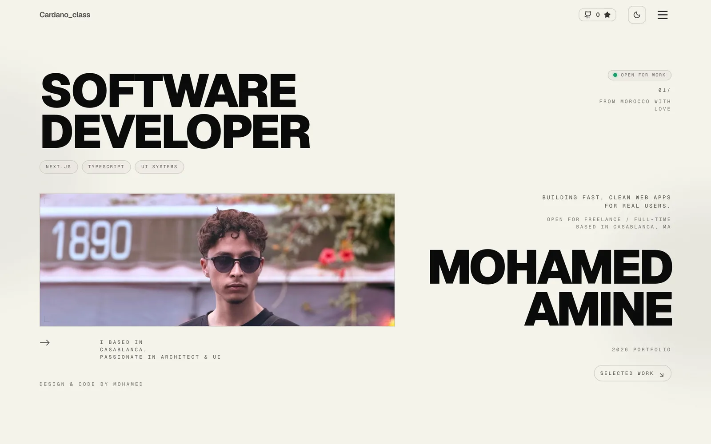
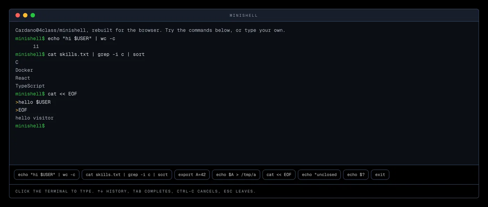
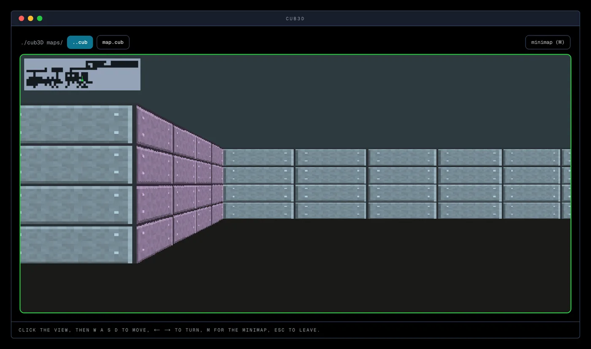
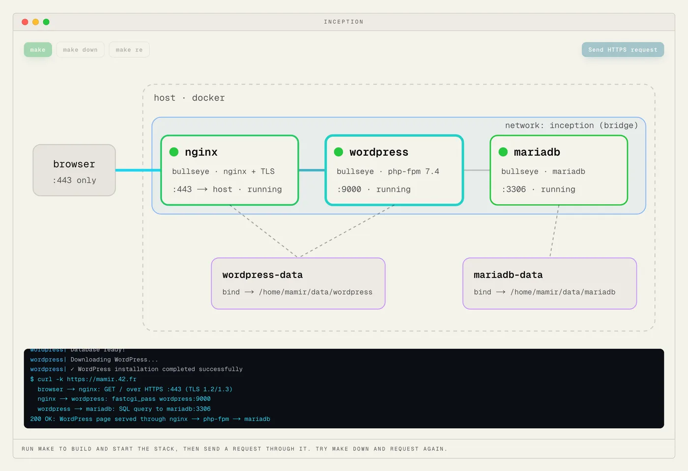
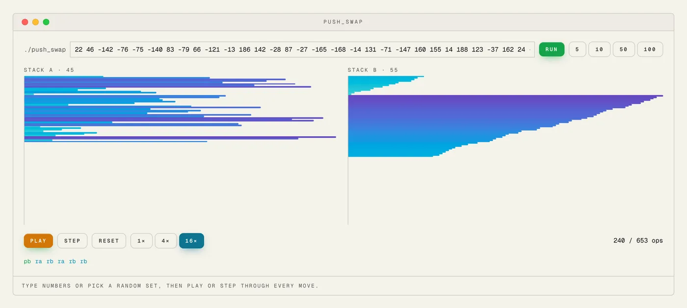
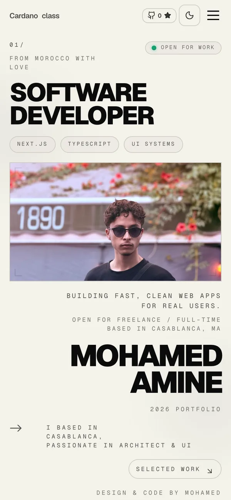

<div align="center">

<a href="https://m-amir.xyz">
  <picture>
    <source media="(prefers-color-scheme: dark)" srcset="docs/readme/hero-dark.webp">
    
  </picture>
</a>

<h1>Mohamed Amine</h1>

<p><strong>Software developer from Casablanca. I build fast, clean web apps, and this site is one of them.</strong></p>

<p>
  <a href="https://m-amir.xyz"><b>m-amir.xyz</b></a>
  &nbsp;·&nbsp;
  <a href="https://github.com/Cardano04class">GitHub</a>
  &nbsp;·&nbsp;
  <a href="https://www.linkedin.com/in/mohamedamineamir/">LinkedIn</a>
  &nbsp;·&nbsp;
  <a href="mailto:cardano_class@proton.me">cardano_class@proton.me</a>
</p>

<p>
  
  
  
  
  
  
</p>

</div>

<br>

## Projects you can run in the page

Each project page has a **Try it** panel: a small, faithful rebuild of the original project that runs in the browser. Messages, limits and quirks are copied from the real repositories, and each demo loads only on its own page.

<table>
  <tr>
    <td width="50%" valign="top">
      <a href="https://m-amir.xyz/projects/minishell"></a>
      <p><b><a href="https://m-amir.xyz/projects/minishell">minishell</a></b>: a bash-like shell in C. Pipes, redirections, heredocs, <code>$?</code> and builtins, checked against the compiled binary on 75 scripts.</p>
    </td>
    <td width="50%" valign="top">
      <a href="https://m-amir.xyz/projects/cub3d"></a>
      <p><b><a href="https://m-amir.xyz/projects/cub3d">cub3D</a></b>: a Wolfenstein-style raycaster in C. The same DDA, textures and collision, on the repo's own maps. WASD to walk.</p>
    </td>
  </tr>
  <tr>
    <td width="50%" valign="top">
      <a href="https://m-amir.xyz/projects/inception"></a>
      <p><b><a href="https://m-amir.xyz/projects/inception">Inception</a></b>: NGINX, WordPress and MariaDB in Docker. Run <code>make</code>, then follow a request through 443, 9000 and 3306.</p>
    </td>
    <td width="50%" valign="top">
      <a href="https://m-amir.xyz/projects/push_swap"></a>
      <p><b><a href="https://m-amir.xyz/projects/push_swap">push_swap</a></b>: sorting with two stacks. The cheapest-move algorithm, matching the C program's output move for move.</p>
    </td>
  </tr>
</table>

Also on the site: **[ClubsHub](https://m-amir.xyz/projects/clubshub)**, a platform for 1337's student clubs, built by a team of five.

<br>

## Built with care

<table>
  <tr>
    <td valign="middle" width="58%">

- **Static by design.** Next.js App Router with `output: "export"`. No server, no database, no secrets in the bundle.
- **Light where it counts.** Each demo is its own chunk, loaded only on its project page, and pauses when scrolled away or when the tab is hidden.
- **Motion with manners.** GSAP, Motion and Lenis smooth scrolling. With `prefers-reduced-motion`, smooth scrolling, section reveals and demo autoplay switch off.
- **Two themes.** Light and dark, chosen by the visitor.
- **Accessible.** Real buttons and labels, focus rings, keyboard play that never hijacks page scroll, and touch controls on phones.
- **Tested.** Every demo's core logic runs under `node --test` with no test framework.

</td>
    <td valign="top" width="42%" align="center">
      
    </td>
  </tr>
</table>

<br>

## Run it locally

```bash
git clone https://github.com/Cardano04class/portfolio-website.git
cd portfolio-website
npm install
npm run dev      # http://localhost:3000
```

| Command | What it does |
| --- | --- |
| `npm run dev` | Development server with hot reload |
| `npm run build` | Static export to `out/` |
| `npm test` | Unit tests for the demo logic (Node 22+) |
| `npm run lint` | ESLint |

<details>
<summary><b>Project layout</b></summary>

```
app/
  components/        page sections, navbar, hero
  components/demos/  one folder per Try it demo, plus the shared frame
  data/              projects, socials, site URL
  projects/[slug]/   project detail pages (statically generated)
src/projects/        project images, one folder per project
docs/readme/         the screenshots in this README
```

</details>

<details>
<summary><b>Deploying</b></summary>

Vercel's production branch is `prod`. Pushing `main` does not deploy (`vercel.json`); other branches get preview URLs.

To release what is on `main`:

```bash
git push origin main:prod
```

To roll back, promote an earlier deployment in the Vercel dashboard.

</details>

<br>

<div align="center">
<sub>Designed and built by <a href="https://github.com/Cardano04class">Mohamed Amine</a> in Casablanca, Morocco.</sub>
</div>
